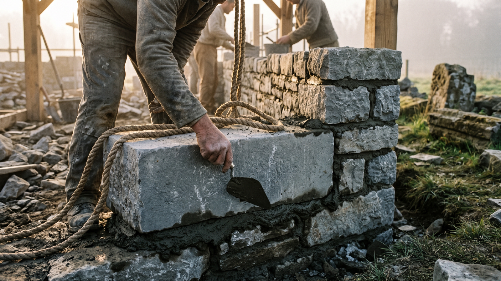
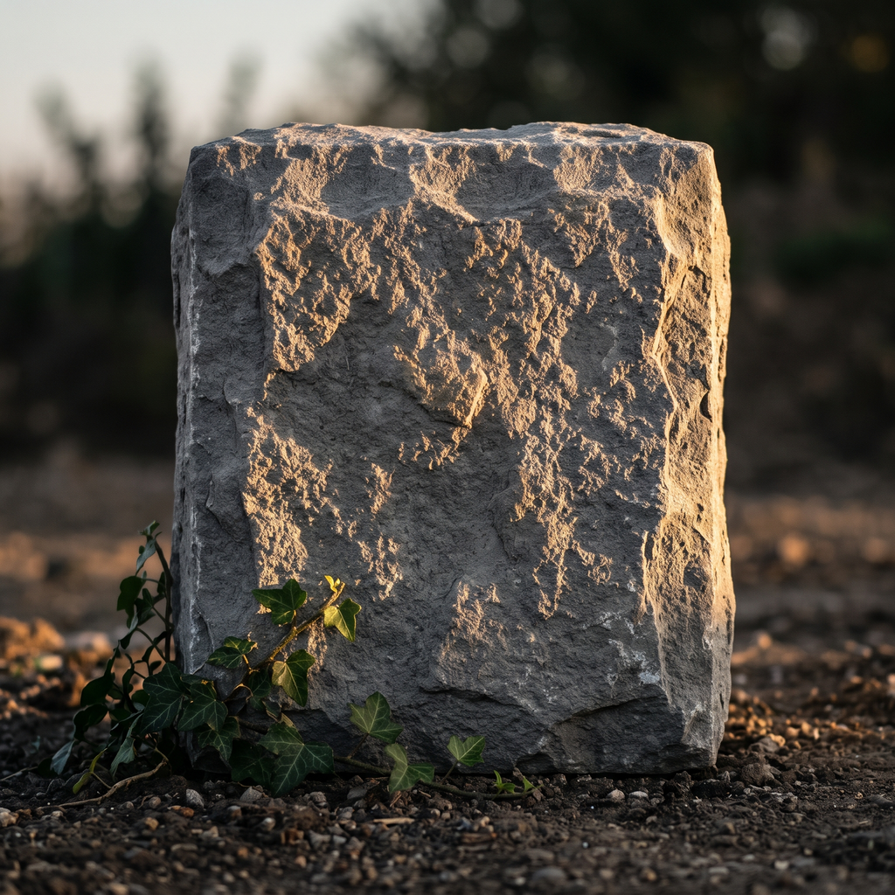
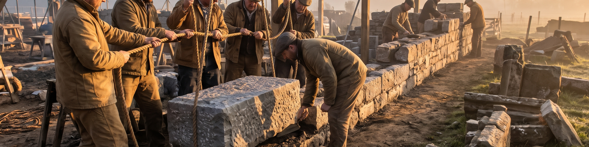
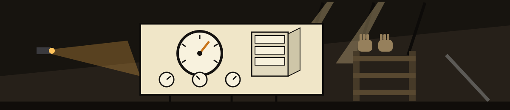
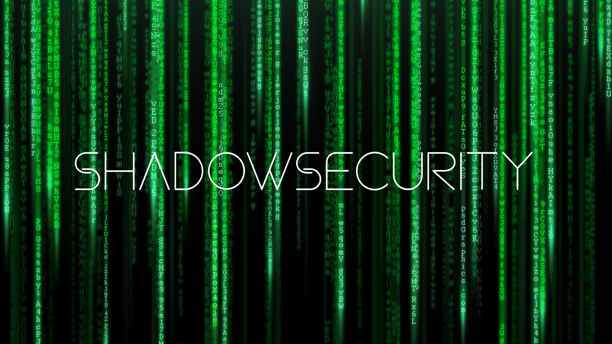
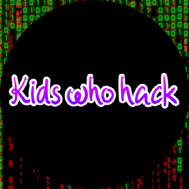
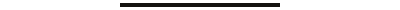

# ShadowSecurity-Tribute

> **Note taped inside the cupboard door:** Shadow-Linux.sh and Shadow-Mac.sh are placeholders for unwritten scripts, and the original organisation code could not be restored after deletion.

---

  

---

---

ShadowSecurity was an organization founded by me later shutdown after one year, this is a tribute. However, I'd like to specify only the older version was shutdown and this new better version will live on.

---

# Tribute

---

  

---

In tribute to ShadowSecurity I will be providing Shadow-Linux code and mantaining the code for the future allowing all my favorite penetration testing GNU/Linux operating systems to be installed in one operating system. This was the idea that founded all of ShadowSecurity before ShadowSecurity branched out and I feel Shadow-Linux should be what ends it. In someways this code I provide is better it contains no branding allowing me to get away with purely installing bedrock linux and making the changes rather than forking the project. In this project the videos of Shadow-Music and Shadow-Website PWA will be provided as a release and I possibly will create the never created macos penetration testing script.

# The Rise and Fall of ShadowSecurity

ShadowSecurity was a non-profit organization founded by myself with the aim of creating security tools and software to help individuals and organizations protect themselves against cyber threats. Unfortunately, due to my own ambitious nature, the organization eventually shut down as I had too many projects to manage.

Some of the projects we worked on included Shadow-Live, which aimed to create a customizable penetration testing distribution with backups. However, we determined that it was pointless to maintain as there weren't enough changes from RescueZilla, the distribution we had forked.

We also had projects such as Shadow-Windows, which was shut down due to potential copyright issues that would arise from creating a project such as this, and Shadow-Mac, which was also shut down for the same reason but may be reopened in the future as a script and not a custom OS.

Other community projects included Shadow-Website, a website that I still have screenshots and videos of the PWA in action, but unfortunately lost the code. Shadow-Music was also a community project that utilized somafm and was a fork of someone's somafm online player. I still have videos of Shadow-Music in action, but the code was lost upon shutting down the organization.

Finally, I realized that I had tried to reinvent the wheel and do too much when the main focus of the organization should have been my script Shadow-Linux. It was the flagship product that combined all pentesting linux distributions into one by forking Bedrock Linux. As a result, the only thing I kept from this organization was Shadow-Linux. All other community projects such as Shadow-Game, Shadow-Blog, Shadow-News, Shadow-Community, and Shadow-Storage shutdown due to lack of time.

In conclusion, ShadowSecurity had a lot of potential, but my ambition got the better of me. I learned that focusing on one core product is the key to success in any project, and I hope to apply this lesson to any future endeavors I undertake.

# KidsWhoHack Tribute

---

  

---

I founded an organization called "KidsWhoHack" with the goal of teaching cybersecurity to kids. However, after creating a course for the organization, I found it pointless to reinvent the wheel with a course when text-based content is just as effective if not more effective for learning. As a result, I shifted my focus to creating presentations and blogs, which were much easier to manage and more accessible to a wider audience. Eventually, I decided to shut down the organization and focus on creating text-based content for learning cybersecurity. While "KidsWhoHack" may be gone, its legacy lives on in the text-based content I continue to create.

# What will happen?

Shadow-Linux will essentially become one giant regex script
Shadow-Mac will setup a mac with the best penetration testing tools and config OOBE (Out-Of-Box)

# Archive Attempt:
https://docs.github.com/en/repositories/creating-and-managing-repositories/restoring-a-deleted-repository
Now as the code was in a organization I have an active attempt to restore the code using this link ^ however, all of the organization was deleted so I cannot get to this menu in order to start the project and archive it under my account.

https://stackoverflow.com/questions/66568042/how-do-i-restore-a-deleted-organisation-on-github

https://github.blog/changelog/2019-09-30-restore-deleted-repositories/

It seems this attempt would be trivial

# What I learned?

Throughout many of these organizations I learned many many things and have invaluable knowledge of mistakes you could make, In most of these projects I let my ambition get the best of me resulting in the inevitable death of them. However, they will live on in other forms.
